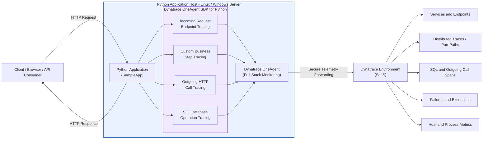
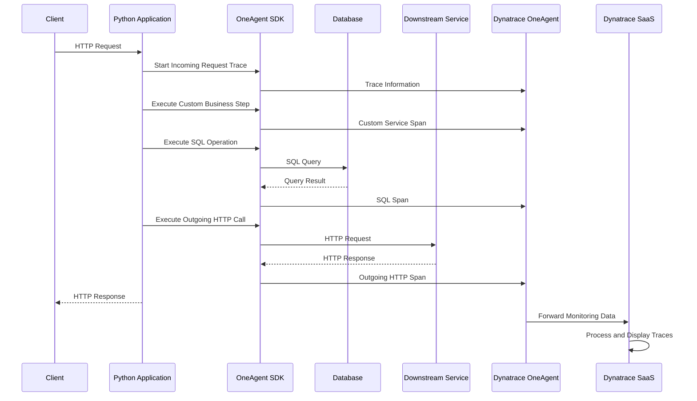
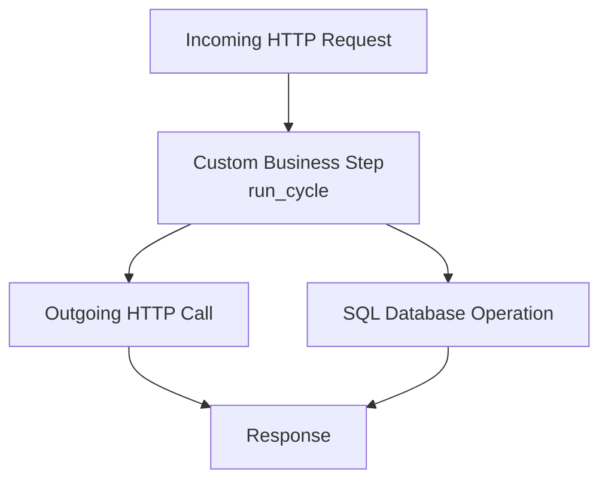

# Dynatrace OneAgent SDK for Python – Application Code-Level Tracing

A practical, step-by-step guide to integrating the Dynatrace OneAgent SDK for Python into a Python application, validating end-to-end tracing, testing failure scenarios, and troubleshooting common issues.

**Project:** Dynatrace OneAgent SDK for Python  
**Document ID:** SOP-DT-PY-002  
**Version:** 1.0  
**Author:** Gajanan Kalkundre  

---
### High-Level Architecture


## 1. Overview

This repository demonstrates how to implement application-level tracing in a Python application using the **Dynatrace OneAgent SDK for Python**.

Dynatrace OneAgent provides host and process-level monitoring. However, to capture application-level details such as incoming requests, internal business operations, SQL queries, outgoing HTTP calls, and exceptions, the application needs to be instrumented using the OneAgent SDK.

This implementation demonstrates how to:

- Integrate the Dynatrace OneAgent SDK into a Python application.
- Monitor incoming HTTP requests and application endpoints.
- Trace custom business operations and internal methods.
- Monitor outgoing HTTP calls to downstream services.
- Capture SQL database operations.
- Identify application failures and exceptions.
- Analyse distributed traces and PurePaths in Dynatrace.


## 2. Architecture – Dynatrace OneAgent SDK for Python

The following architecture illustrates how a Python application communicates with Dynatrace through the OneAgent SDK and the Dynatrace OneAgent installed on the application host.

### High-Level Architecture



### Architecture Components

| Component | Description |
|---|---|
| Client / Browser | Sends HTTP requests to the Python application. |
| Python Application | Application containing business logic and API endpoints. |
| OneAgent SDK for Python | Adds code-level tracing to application operations. |
| Dynatrace OneAgent | Runs on the application host in Full-Stack monitoring mode and captures SDK telemetry. |
| Dynatrace SaaS | Receives and processes monitoring data. |
| Distributed Tracing | Displays requests, internal operations, SQL calls, and outgoing HTTP calls. |

### Application Request and Tracing Flow



### Expected Dynatrace Visibility

After successful integration, the following information can be viewed in Dynatrace:

- Application service and endpoint details.
- Distributed traces / PurePaths.
- Incoming request duration.
- Custom business operation duration.
- SQL database operations.
- Outgoing HTTP calls.
- Application exceptions and failures.
- Host and process-level metrics.

---

## 3. Prerequisites

Before starting the integration, verify the following requirements.

| Component | Requirement |
|---|---|
| Dynatrace OneAgent | Installed and running in Full-Stack mode |
| OneAgent Version | Version 1.251 or newer |
| Python | CPython 3.8 or newer |
| Architecture | x86 / x86-64 |
| Operating System | Linux or Windows Server |
| Linux Distribution | glibc-based Linux; Alpine/musl is not supported |
| Python SDK | `oneagent-sdk` |
| Permissions | Application user should have permission to create and use the virtual environment |

**Important:** The SOP was tested on Linux, with Windows Server as the production target.

---

## 4. Implementation Steps

### Step 1: Prepare the Python Environment

Create a Python virtual environment inside the application directory.

#### Linux

```bash
python3 -m venv venv

source venv/bin/activate

python -m pip install --upgrade pip setuptools wheel

python -m pip install oneagent-sdk
```

#### Windows Server

```powershell
py -m venv venv

venv\Scripts\activate

py -m pip install --upgrade pip setuptools wheel

py -m pip install oneagent-sdk
```

**Note:** Create and manage the virtual environment using the application user. Do not use `sudo` for the virtual environment or pip installation.

### Step 2: Verify SDK Initialization

Execute the following command:

```bash
python -c "import oneagent; print(oneagent.initialize())"
```

Expected result:

```text
STATUS_INITIALIZED
error=None
```

If the output reports `Could not load agent`, the SDK package may be installed, but Dynatrace OneAgent is not available to the application process.

Check the OneAgent service and host configuration.

### Step 3: Start the Python Application

Start the application using the Python interpreter from the virtual environment.

```bash
venv/bin/python sample_app.py --mode server --port 8085
```

For Windows, use the Python executable inside the virtual environment.

Expected application startup log:

```text
agent_state=0 (ACTIVE)
```

The application should run with an active OneAgent SDK connection.

**Important:** If the agent state is not `ACTIVE`, the application will not send the expected traces.

### Step 4: Verify Application Availability

From another terminal, execute:

```bash
curl http://localhost:8085/health
```

Open the application in a browser:

```text
http://<server-ip>:8085/
```

Verify that the application is accessible and its endpoints are responding.

### Useful Application Environment Variables

| Variable | Description |
|---|---|
| `APP_URL` | Target URL for outgoing HTTP calls |
| `APP_TIMEOUT` | Timeout for outgoing calls |
| `APP_SERVICE_NAME` | Application service name in Dynatrace; default is `SampleApp` |
| `APP_DB` | Application database configuration |
| `APP_LOG` | Application log configuration |

---

## 5. Verify Process Detection in Dynatrace

After starting the Python application:

1. Log in to the Dynatrace environment.
2. Navigate to **Compute → Processes**.
3. Search for the Python application process.
4. Open the relevant process group.
5. Verify CPU, memory, and network metrics.

At this stage, process-level monitoring can be available even before application services and traces are generated.

---

## 6. Instrument the Python Application

The OneAgent SDK integration adds tracing functionality to the Python application code.

The SDK-related code changes are marked with `SDK ADDED` comments in the sample application.

### Instrumentation Overview

| Step | Application Code Area | SDK Implementation | Dynatrace Visibility |
|---|---|---|---|
| 1 | Top of the file | `import oneagent` | SDK dependency |
| 2 | `init_sdk()` | Initialize SDK and log agent state | Agent state |
| 3 | Database helper | `trace_sql_database_request` | SQL operation spans |
| 4 | HTTP helper | `trace_outgoing_web_request` | Outgoing HTTP spans |
| 5 | Business operations | `trace_custom_service` | Custom business spans |
| 6 | Request handler | `trace_incoming_web_request` | Incoming requests and endpoints |
| 7 | Application shutdown | `oneagent.shutdown()` | Clean SDK shutdown |

### 6.1 Import the SDK

Add the following import to the Python application:

```python
import oneagent
```

### 6.2 Initialize the SDK

Initialize the OneAgent SDK when the application starts.

The initialization function should:

- Initialize the SDK.
- Check the agent state.
- Log the initialization status.
- Create reusable database and web application information.

The expected agent state is:

```text
agent_state=0 (ACTIVE)
```

### 6.3 Incoming Request Tracing

Use the SDK's incoming web request tracing functionality to trace application endpoints.

The implementation uses:

```python
trace_incoming_web_request
```

This captures incoming application requests and makes endpoint-level tracing available in Dynatrace.

Apply tracing to business endpoints rather than health checks, UI pages, or UI data endpoints.

### 6.4 Custom Business Operation Tracing

Use `trace_custom_service` to trace internal business operations.

Example:

```python
with sdk.trace_custom_service("run_cycle", "SampleApp"):
    fetch_remote_data()
    store_records(5)
```

This creates a custom span for the `run_cycle` operation.

Other examples of business operations include:

- `checkout_flow`
- `validate_order`
- `run_cycle`

### 6.5 Outgoing HTTP Call Tracing

Use:

```python
trace_outgoing_web_request
```

This traces outgoing HTTP calls from the Python application to downstream services.

The implementation passes the Dynatrace tag in the outgoing request header to support trace correlation.

Expected Dynatrace visibility:

- Outgoing HTTP request.
- Target service.
- Call duration.
- Request status.
- Failed outgoing calls.

### 6.6 SQL Database Operation Tracing

Use:

```python
trace_sql_database_request
```

Wrap SQL statements using the SDK's database tracing functionality.

Expected SQL operations include:

- INSERT
- SELECT
- UPDATE
- DELETE

**Important:** SQL spans are recorded inside another SDK trace. Ensure database calls execute within a traced endpoint or custom business operation.

### 6.7 SDK Shutdown

The application should shut down the SDK cleanly when the application stops.

Use:

```python
oneagent.shutdown()
```

Call this during the application's normal shutdown process.

---

## 7. Verify Application Traces in Dynatrace

After completing the SDK integration:

1. Generate application traffic by accessing the endpoints.
2. Log in to the Dynatrace environment.
3. Navigate to **Distributed Tracing → Explorer**.
4. Set the time range to the last 30 minutes.
5. Refresh the trace view.
6. Search for the application service name, such as `SampleApp`.
7. Open an individual trace.
8. Verify the request, custom business operation, outgoing HTTP call, and SQL statements.

Allow a few minutes for the first traces to appear.

If the Requests view displays no matching requests, switch to the Spans view.

### Expected Trace Structure



### Expected Dynatrace Results

| Monitoring Item | Expected Result |
|---|---|
| Service | `SampleApp` |
| Endpoint | Application endpoint such as `/work` |
| Custom Span | `run_cycle` |
| Outgoing Call | Downstream HTTP request |
| Database Span | SQL statement |
| Failure Details | Exception type and error message |
| Trace Details | Request duration and individual span duration |

---

## 8. Application Failure Scenarios

The sample application includes dedicated failure endpoints to validate application error monitoring.

### Failure Endpoint Details

| Endpoint | Failure Scenario | HTTP Status | Expected Dynatrace Visibility |
|---|---|---:|---|
| `/fail/exception` | Exception inside a traced business step | 500 | Failed request and failed `validate_order` span |
| `/fail/db` | SQL error due to a missing table | 500 | Failed SQL span |
| `/fail/downstream` | Downstream service unavailable | 502 | Failed outgoing HTTP span |
| `/fail/timeout` | Outgoing call timeout | 504 | Slow and failed outgoing call |
| `/fail/random` | Random application failures | 500 | Service failure rate |
| `/error` | Unhandled application error | 500 | Failed request |
| `/checkout?fail=1` | Payment service declines the transaction | 402 | Linked requests; not a server-side failure by default |

### Trigger Failure Scenarios

Use the application UI and click the failure scenario buttons.

Alternatively, execute the following commands:

```bash
curl -i http://localhost:8085/fail/exception

curl -i http://localhost:8085/fail/db

curl -i http://localhost:8085/fail/downstream

curl -i http://localhost:8085/fail/timeout

curl -i http://localhost:8085/fail/random

curl -i http://localhost:8085/error

curl -i "http://localhost:8085/checkout?fail=1"
```

### Analyse Failures in Dynatrace

1. Open **Distributed Tracing → Explorer**.
2. Set the time range to the last 30 minutes.
3. Filter for failed requests or spans.
4. Open a failed trace.
5. Identify the failed span.
6. Check the exception type and message.
7. Review the Logs tab for related log lines.
8. Open **Services → SampleApp** to review failure rate and response time.

### HTTP Failure Detection

By default, Dynatrace treats HTTP status codes from 500 to 599 as server-side failures.

Client error codes such as 402 and 404 are not counted as server-side failures by default.

If required, configure additional failure detection rules through:

**Settings → Process and contextualize → Services → Failure detection rules**

Menu names may differ slightly between Dynatrace versions.

---

## 9. Troubleshooting

| Issue | Possible Cause | Recommended Action |
|---|---|---|
| Permission denied inside virtual environment | Virtual environment created using another user or sudo | Correct directory ownership or recreate the virtual environment as the application user |
| Cannot connect to port 8085 | Application is not running or port is already in use | Check the application process and port availability |
| Port already in use | Previous application process is still running | Stop the old process or use another port |
| `Could not load agent` | OneAgent is not running or available to the process | Verify OneAgent service and restart the application |
| `agent_state=1 (TEMPORARILY_INACTIVE)` | OneAgent is not capturing for the process | Verify Full-Stack monitoring mode, process monitoring, and OneAgent health; restart the application |
| Process visible but no traces | SDK is inactive or traced code has not executed | Verify `agent_state=0`, generate traffic, and check the time range |
| SQL spans missing | SQL call is not inside another SDK trace | Execute database calls inside a traced endpoint or business step |
| HTTP 402 or 404 not shown as failure | These codes are not server-side failures by default | Review and update failure detection rules if required |
| Application crashes during shutdown | SDK shutdown was not handled correctly | Call `oneagent.shutdown()` during clean shutdown |

### SDK Debugging

For temporary SDK debugging, use:

```bash
export DT_LOGLEVELSDK=finest
export DT_LOGLEVEL=finest
```

Restart the application and review the OneAgent logs on the host.

Remove these debugging settings after troubleshooting.

---

## 10. Final Verification Checklist

| # | Verification Item | Status |
|---:|---|---|
| 1 | Python virtual environment created successfully | [ ] |
| 2 | `oneagent-sdk` installed successfully | [ ] |
| 3 | SDK initialization returns `STATUS_INITIALIZED` | [ ] |
| 4 | Application startup log shows `agent_state=0 (ACTIVE)` | [ ] |
| 5 | Application health endpoint responds successfully | [ ] |
| 6 | Python process is visible in Dynatrace | [ ] |
| 7 | Application service and endpoints appear in Dynatrace | [ ] |
| 8 | Distributed traces are available | [ ] |
| 9 | Custom business operation spans are visible | [ ] |
| 10 | Outgoing HTTP spans are visible | [ ] |
| 11 | SQL database spans are visible | [ ] |
| 12 | Failure scenarios are visible in Dynatrace | [ ] |

---

## 11. Rollback Plan

If the SDK integration needs to be rolled back:

1. Redeploy the previous application version without the SDK code.
2. Restart the Python application.
3. Verify application availability.
4. Confirm that OneAgent process-level monitoring remains unaffected.

Removing the SDK integration does not require uninstalling Dynatrace OneAgent from the host.

---

## 12. Important Notes

- Dynatrace OneAgent must be installed and running on the application host.
- Full-Stack monitoring mode is required for the tracing implementation described in this SOP.
- The application must be restarted after OneAgent installation or relevant configuration changes.
- The SDK must be initialized before the application starts processing requests.
- SQL calls must execute within a traced request or business operation.
- Exceptions leaving a traced operation are recorded as failures.
- Generate application traffic to validate the traces.
- Use clean SDK shutdown handling when stopping the application.

---

## 13. References

- [Dynatrace OneAgent SDK for Python – GitHub](https://github.com/Dynatrace/OneAgent-SDK-for-Python)
- [Dynatrace OneAgent SDK for Python – API Documentation](https://dynatrace.github.io/OneAgent-SDK-for-Python/)
- [Dynatrace Service Failure Detection](https://docs.dynatrace.com/docs/shortlink/service-failure-detection)

---

## 14. Repository Structure

Suggested GitHub repository structure:

```text
dynatrace-python-oneagent-sdk/
│
├── README.md
│
├── sample-app/
│   ├── sample_app.py
│   └── requirements.txt
│
├── architecture/
│   └── architecture-diagram.png
│
├── screenshots/
│   ├── 01-sdk-initialization.png
│   ├── 02-application-startup.png
│   ├── 03-application-ui.png
│   ├── 04-process-detection.png
│   ├── 05-distributed-traces.png
│   ├── 06-trace-details.png
│   ├── 07-failure-analysis.png
│   └── 08-span-details.png
│
└── docs/
    └── SOP-Dynatrace-OneAgent-SDK-Python.md
```

### Adding Architecture Image

Save the architecture diagram in the `architecture` folder and use the following Markdown in this README:

```markdown

```

### Adding Dynatrace Screenshots

Example:

```markdown
### SDK Initialization


### Application Startup


### Distributed Traces


### Failure Analysis


```

---

## Conclusion

The Dynatrace OneAgent SDK for Python enables code-level application tracing by connecting application operations with Dynatrace OneAgent.

With this implementation, teams can monitor application endpoints, identify slow business operations, analyse SQL queries, track outgoing HTTP calls, and troubleshoot application failures through distributed traces in Dynatrace.

This improves application observability and helps development and monitoring teams identify the root cause of application performance issues.
